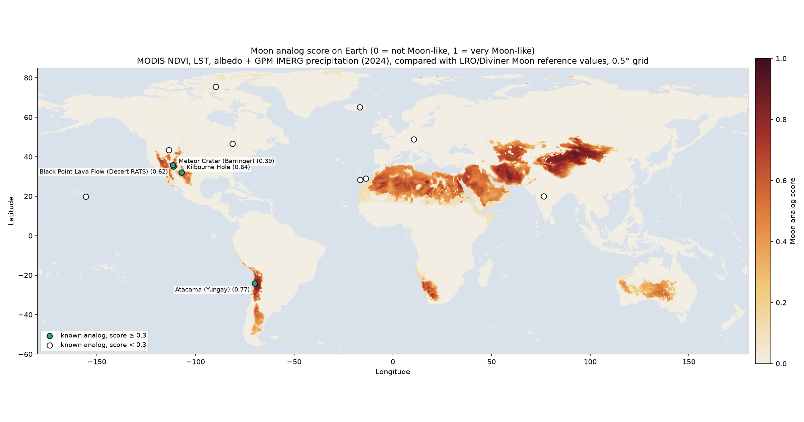

# Moon Analogs on Earth 🌍🌕

**NASA Space Apps Challenge 2026** · Team **6/8**

Finding new Moon-like places on Earth.

Planetary analog sites let NASA test technology, operations and astronaut training on Earth before going to the Moon or Mars. A site doesn't need to match every property of the Moon: a few matching characteristics are enough to make it interesting.

We compare NASA Earth observation data with Moon reference values and compute a **Moon analog score between 0.0 and 1.0** for every 0.5° grid cell on land. The result is a global heatmap that shows where Earth looks most like the Moon. Because we score a global grid instead of a fixed list of sites, the method can also **discover places** that are not yet known as analogs.



---

## How it works

1. **Data**: five NASA datasets from 2024 are downloaded with `earthaccess` and resampled to a common 0.5° grid (`data/features.nc`).
2. **Sub-scores**: each feature is compared with the Moon and turned into a sub-score between 0 and 1.
3. **Local score**: the sub-scores are combined with a weighted *geometric* mean, so a place has to be Moon-like in *every* feature to score high (a dry but green place still scores ~0).
4. **Validation**: the score is checked against a list of known Moon analog sites (`data/known_analogs.csv`).

### Features and rules

The Moon reference values are stored in `data/moon_reference.json`. Lunar surface temperatures come from the Diviner instrument on the Lunar Reconnaissance Orbiter: about 390 K at the equator at noon, dropping to about 95 K just before sunrise (Williams et al. 2017).

Many Moon values do not exist anywhere on Earth (e.g. a day/night surface temperature difference of ~295 K). A bell curve around the Moon value would give 0 everywhere, so most rules mean *"the closer to the Moon, the better"*, scaled to what Earth can reach: **bad = Earth land median, good ≈ 99th percentile of Earth land cells**.

| Category | Feature | Source | Moon | Score 0 → 1 | Weight |
|---|---|---|---|---|---|
| Environment | Max. vegetation index (NDVI) | MODIS MOD13C2 | 0 | 0.3 → 0.05 | 2.0 |
| Environment | Precipitation (mm/year) | GPM IMERG monthly | 0 | 400 → 25 | 2.0 |
| Environment | Mean day/night LST difference (K) | MODIS MOD11C3 | ~295 | 5 → 20 | 1.0 |
| Environment | Annual LST span, max − min (K) | MODIS MOD11C3 | ~295 | 33 → 60 | 1.0 |
| Surface | Shortwave albedo | MODIS MCD43C3 | ~0.07 | 0.45 → 0.10 | 1.5 |

The albedo rule also takes care of ice and snow: Greenland and Antarctica have almost no vegetation, but their high albedo pushes the sub-score, and with the geometric mean the total score, to ~0.

Cells with too little data (coverage < 50 %, e.g. oceans with only precipitation) get no score. All rules are configured in `TARGETS` in [`score.py`](score.py). Units and the direction of each raw feature are documented in [`DATA_DICTIONARY.md`](DATA_DICTIONARY.md).

---

## Results

- **95,561** land cells scored.
- Highest scores (up to **0.95**) in the eastern Tarim Basin / Gobi region (~40–42° N, 92–94° E), followed by the Atacama/Puna, the Sahara, the Arabian Peninsula, the US Southwest, southern Africa and central Australia.
- Known **desert** analogs land in the top few percent of all land cells:

| Known analog | Score | Better than … of land cells |
|---|---|---|
| Atacama (Yungay) | 0.77 | 99 % |
| Kilbourne Hole | 0.64 | 98 % |
| Black Point Lava Flow (Desert RATS) | 0.62 | 98 % |
| Meteor Crater (Barringer) | 0.39 | 93 % |

### Limitations

- Known **geological** analogs in humid or green regions (Iceland, Hawaii, Nördlinger Ries, Lonar, Sudbury) score low: our features describe climate and surface, not rock type, craters or terrain.
- A 0.5° cell is ~55 km wide, so small sites such as single craters are averaged out.
- One year of data (2024).

### Next steps

- **Rock type:** add the ASTER GED basalt index (already prepared in `data_prep/prepare_aster.py`).
- **Landforms:** add terrain (slope, roughness from NASADEM or Copernicus DEM) and distance to impact structures and volcanic fields (Smithsonian Global Volcanism Program).
- **Caves and lava tubes:** potential lunar habitats. There is no global dataset, so this needs curated site lists.
- **Zoom-in on top candidates** with high-resolution data (ASTER GED 100 m, NASADEM 30 m, Sentinel-2) and side-by-side comparison with LRO LROC imagery.
- **Mars:** the same pipeline with Martian reference values and mineralogy from EMIT (iron oxides, clay minerals).
- Higher resolution and an interactive 3D globe.

---

## Run it

```bash
pip install -r requirements.txt
python score_map.py     # score for every grid cell + known analogs -> data/
python plot_scores.py   # heatmap -> moon_score_map.png
```

`data/features.nc` is included, so the raw data is not needed to reproduce the results.

### Rebuilding the features from scratch

You need:

1. A free **NASA Earthdata login** at [urs.earthdata.nasa.gov](https://urs.earthdata.nasa.gov).
2. Under *Applications → Authorized Apps*, approve **"NASA GESDISC DATA ARCHIVE"** (for GPM) and **"LP DAAC Data Pool"**, including their EULAs. Without this, downloads fail with `EulaNotAccepted`.

Then (several GB of raw data):

```bash
python download.py
python data_prep/prepare_modis.py   # NDVI, LST, albedo
python data_prep/prepare_gpm.py     # precipitation
python data_prep/prepare_aster.py   # basalt index (not yet used in the score)
python data_prep/build.py           # -> data/features.nc
```

---

## Files

| File | Purpose |
|---|---|
| `score.py` | scoring rules and functions (sub-scores, weighted combination) |
| `score_map.py` | scores the whole grid and the known analog sites |
| `plot_scores.py` | draws the world heatmap |
| `places.py` | helper for single places (load from CSV, look up grid values, rank) |
| `download.py` | downloads the NASA datasets via `earthaccess` |
| `data_prep/` | preprocessing: reading HDF files, scaling, yearly aggregation, resampling to 0.5° |
| `data/features.nc` | raw feature values per 0.5° cell |
| `data/moon_reference.json` | Moon reference values |
| `data/known_analogs.csv` | known Moon analog sites used for validation |
| `DATA_DICTIONARY.md` | units, sources and direction of every feature |

---

## Data and references

**Used in the score**
- MODIS/Terra Vegetation Indices Monthly L3 Global 0.05Deg CMG (MOD13C2, v061)
- MODIS/Terra Land Surface Temperature/Emissivity Monthly L3 Global 0.05Deg CMG (MOD11C3, v061)
- MODIS/Terra+Aqua BRDF/Albedo Albedo Daily L3 Global 0.05Deg CMG (MCD43C3, v061)
- GPM IMERG Final Precipitation L3 1 month 0.1° (GPM_3IMERGM, v07)
- Moon temperatures: Williams, J.-P. et al. (2017), *The global surface temperatures of the Moon as measured by the Diviner Lunar Radiometer Experiment*, Icarus 283, 300–325.

**Prepared, not yet used**
- ASTER Global Emissivity Dataset 5 km (AG5KMMOH, v041)

**For the next steps (from the challenge resources)**
- [NASA Planetary Data System](https://pds.nasa.gov) / LRO LOLA, LROC, Diviner: lunar topography, imagery and temperatures
- [NASA Worldview](https://worldview.earthdata.nasa.gov): visual check of individual sites
- [Copernicus Data Space](https://dataspace.copernicus.eu): Copernicus DEM, Sentinel-1 radar, Sentinel-2 imagery
- RADARSAT (CSA): radar roughness of lava fields, comparable with LRO Mini-RF

All Earth data accessed via [NASA Earthdata](https://search.earthdata.nasa.gov) (`earthaccess`).

---

## Team 6/8

| Member | Role |
|Milan Thiele|Coding the Scoring Algorithm|
| Luis Rennert | Coding the Data Preparation|
|Aniko Hiemisch|Research|
| Helge Dix | Research |
|Richard Wettstein|Advanced Visual Automation & Data Storytelling|
